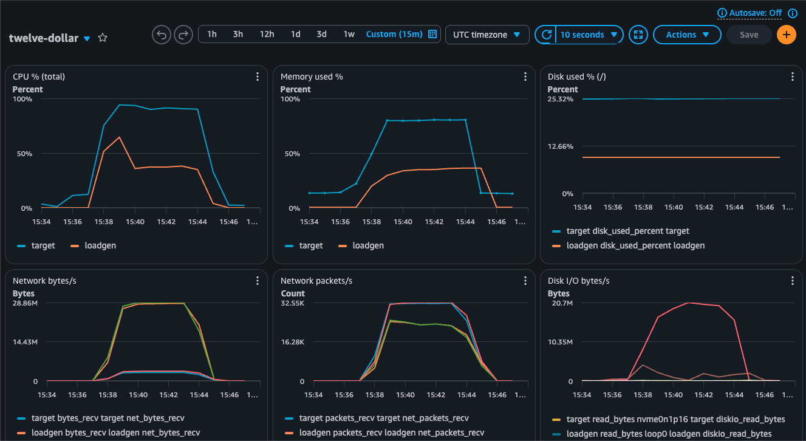

# Twelve-Dollar Server Challenge — own rig

A reproducible copy of the [$12 server challenge](https://github.com/arjaythedev/twelve-dollar-server-challenge)
benchmark on AWS, plus a Go submission tuned to hold 60k virtual users on a 1 vCPU / 2 GB box.

`SPEC.md`, `schema.sql`, `seed/`, `test/`, `bench/load.js` and `bench/nginx.conf` are copied verbatim
from upstream (MIT, see `LICENSE-upstream`, commit in `UPSTREAM_COMMIT`). Everything else is ours.

## Quick start

```bash
make seed                      # seed/feed.db + seed/tokens.json (node >= 18, sqlite3; ~1 min)
make unit test-local           # Go tests + the upstream 42-check suite against a local build
make serve                     # c7a.medium target up, submission built on the box, 42/42 there
make test VUS=60000 DURATION=5m   # one k6 hold from the load generator (created on demand)
make search                    # full methodology: warm-up, raw probe, binary search, 5-min confirm
make backend BACKEND=go        # switch the target's SQLite binding (cgo shim | pure-Go zombiezen); a column in the report
make results                   # pull results/ and rebuild results/REPORT.md
make down CONFIRM=yes          # destroy everything
```

AWS profile defaults to `viacheslav-dev` / `eu-west-1` (override `AWS_PROFILE`, `AWS_REGION`).
`make status` lists every instance tagged `Project=twelve-dollar`, in case state is lost.

**CPU and memory in CloudWatch.** EC2's built-in charts cannot see guest memory and sample CPU every
5 minutes, so both boxes run the CloudWatch agent with a CPU + memory config (IAM role
`twelve-dollar-cwagent`), publishing to the custom namespace `twelve-dollar` with a
`role=target|loadgen` dimension. `make dashboard` creates the `twelve-dollar` dashboard (two charts,
both roles) and prints its URL; `make serve` creates it too. CloudWatch lags 1–2 min, so for a live
view during a hold use `tail -f /srv/app/metrics.csv` on the target. The agent costs the target
~40 MB RSS; the 5-second sampler in `bench/sample-host.sh` remains the source for the report.

**Code reaches the boxes only through GitHub.** Both instances `git clone`
`https://github.com/savak1990/twelve-dollar-server-challenge.git` (`REPO_REF=main`) at boot; the
target then runs `scripts/bootstrap-target.sh` (install toolchain, build from source, build the seed
DB once, fresh DB, start, 42 checks). `make deploy` pulls the ref on the target and re-runs it;
`make test`/`make search` pull on the loadgen. So: commit, push, then run make — `make serve` and
`make deploy` warn if the local tree is ahead of the remote. Forks: override `REPO_URL` and
`GH_USER` (the submission folder's suffix).

## Layout

| Path | What |
|---|---|
| `submissions/go-fasthttp-<user>/` | The Go submission, in the upstream PR contract (`install.sh`, `build.sh`, `start.sh`, `README.md`) |
| `infra/` | Terraform: VPC, target `c7a.medium`, optional loadgen `r7a.4xlarge` (on-demand) with 4 private IPs, CloudWatch agent + dashboard |
| `bench/` | upstream `load.js` + our `hold.sh`, `search.sh`, `raw-feed.js`, `sample-host.sh`, `report.sh` |
| `scripts/` | deploy / run-bench / profile / fetch-results helpers used by the Makefile |
| `results/` | per-run k6 summaries + host metrics (gitignored) and `REPORT.md` |
| `docs/superpowers/specs/` | design record |
| `docs/curl-cheatsheet.md` | plain curl for every endpoint and error path, plus how to run a local server |

## Results (2026-10-15, `go-fasthttp-savak1990`, cgo backend)

Scored 5-minute holds, c7a.medium target, k6 on an r7a box in the same AZ, `LimitNOFILE=1048576`
(so above the 65,535 ceiling upstream benchmarks with; rows past ~65k are rig-only numbers).
Pass = p95 < 500 ms, p99 < 1 s, errors < 1 %. Host columns come from the 5-second sampler on the
target; the early rows lost them when the target was rebuilt.

| VUs | verdict | rps | med | p95 | p99 | errors | target CPU | server RAM (anon) | WAL max | loadgen CPU |
|---:|---|---:|---:|---:|---:|---:|---:|---:|---:|---:|
| 1,000 | PASS | 83 | 0.2 ms | 0.3 ms | 0.4 ms | 0 % | ~1 % | 8 MB | 3.9 MB | 0 % |
| 20,000 | PASS | 1,868 | 0.2 ms | 0.4 ms | 15 ms | 0 % | 19 % | 118 MB | 3.8 MB | 5 % |
| 40,000 | PASS | 3,736 | 0.2 ms | 1 ms | 13 ms | 0 % | 33 % | 231 MB | 3.9 MB | 10 % |
| 60,000 | PASS | 5,601 | 0.4 ms | 6.1 ms | 18 ms | 0 % | ~45 % | ~340 MB | 3.9 MB | 15 % |
| 80,000 | PASS | 7,468 | 0.3 ms | 7.1 ms | 21 ms | 0 % | 56 % | 459 MB | 4.0 MB | 21 % |
| 120,000 | PASS | 11,171 | 0.5 ms | 117 ms | 187 ms | 0 % | 80 % | 703 MB | 4.0 MB | 34 % |
| 130,000 | PASS | 12,112 | 0.5 ms | 132 ms | 199 ms | 0 % | 84 % | 760 MB | 3.9 MB | 18 % |
| **135,000** | **PASS** | 12,477 | 0.6 ms | 184 ms | 644 ms | 0 % | 85 % | 795 MB | 3.9 MB | 20 % |
| 140,000 | FAIL | 12,625 | 1.9 ms | 491 ms | 1,820 ms | 0 % | 86 % | 868 MB | 3.9 MB | 41 % |
| 140,000 | PASS | 12,975 | 1.1 ms | 246 ms | 825 ms | 0 % | 89 % | 869 MB | 10.0 MB | 21 % |

**135,000 users confirmed**; 140,000 passes one run in two with p99 inside 20 % of the budget. The
limit is tail latency, never errors or memory: at ~1,000 writes/s the inline `TRUNCATE` checkpoint
(every ~1,000 WAL frames, an fsync on the single DB goroutine) stalls every request behind it, and
from ~120k the queue behind those stalls is what p95/p99 measure. `GODEBUG=gctrace=1` at 140k showed
no GC cycle, so `GOGC=off` + `GOMEMLIMIT=1GiB` is not involved. Memory is linear at ~5.7 KB of
anonymous RSS per connection (goroutine stacks; the Go heap is ~1.3 KB per connection and the request
path allocates nothing).

For comparison, the same server with the pure-Go SQLite binding (`SQLITE_BACKEND=go`, zombiezen /
modernc) at 80,000: PASS, 86 % CPU, p95 104 ms, p99 154 ms, against 56 % / 7.1 ms / 21 ms for the
cgo shim at the same rps.

The 140,000 run as seen by the CloudWatch dashboard (target in blue, loadgen in orange): ramp, five
minutes of hold, ramp-down. Target CPU at ~90 %, memory at 45 % of 2 GB, ~29 MB/s and ~32k packets/s
each way, and the checkpoint traffic on the target's disk.



## Fidelity vs the videos

- Target is a dedicated Zen 4 vCPU (`c7a.medium`), faster than a DigitalOcean shared vCPU. Numbers here are optimistic.
- The target kernel is untouched (rule 11). The systemd unit mirrors upstream (`CAP_NET_BIND_SERVICE`, non-root) except
  for `LimitNOFILE`: upstream caps it at 65535, which is the real ceiling on open connections; this rig defaults to
  1,048,576 so the search can go past 65k users. Numbers above ~65k are not comparable with the leaderboard.
  `make serve TARGET_NOFILE=65535` for a faithful run (replaces the target).
- No ufw on the AWS Ubuntu AMI, so `nf_conntrack` is not loaded: the 64k conntrack wall from the video does not exist here.
  Port 80 is open to `0.0.0.0/0` with unrestricted egress so AWS security-group tracking leaves those flows untracked.
- One k6 process on one box with 4 source IPs instead of four machines. Loadgen CPU is recorded per run; a failing run
  with loadgen CPU > 70 % is flagged loadgen-bound rather than a server failure.

## Cost

| Resource | Hourly | Note |
|---|---|---|
| target `c7a.medium` | ≈ $0.06 | ~$40/month if forgotten — `make down` |
| loadgen `r7a.4xlarge` | ≈ $1.22 (on-demand; spot was reclaimed mid-session and a reclaim voids a hold) | self-terminates after 6 h; `r7a.2xlarge` saturated near 100k VUs |

A full `make search` is roughly 1.5–2 hours ≈ $1–2.
